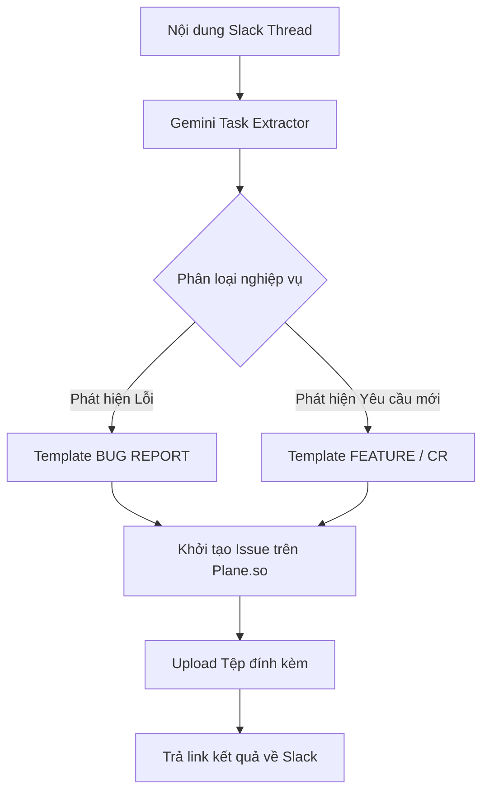

# 📖 Hướng Dẫn Sử Dụng Trợ Lý AI: SRS Assist MVL (@SRS Assist)

> **Dành cho:** Business Analyst (BA), Quality Assurance (QA/Tester), Software Engineers (Dev), Product Owner (PO) và Quản lý dự án thuộc Hệ sinh thái **MaiVietLand ERP**.  
> **Phiên bản:** 2.0 (Railway Dev Edition - RAG FTS5 & Gemini Flash)  
> **Cập nhật lần cuối:** Tháng 10/2026

---

## 📑 Mục lục
1. [Giới thiệu tổng quan](#1-giới-thiệu-tổng-quan)
2. [Các kênh tương tác với Bot](#2-các-kênh-tương-tác-với-bot)
3. [Danh mục tính năng & Cú pháp câu lệnh](#3-danh-mục-tính-năng--cú-pháp-câu-lệnh)
   - [3.1. Tra cứu nghiệp vụ SRS trực tiếp](#31-tra-cứu-nghiệp-vụ-srs-trực-tiếp)
   - [3.2. Sinh tài liệu Use Case chuẩn Karl Wiegers (/usecase)](#32-sinh-tài-liệu-use-case-chuẩn-karl-wiegers-usecase)
   - [3.3. Thiết kế kịch bản kiểm thử UAT (/testcase)](#33-thiết-kế-kịch-bản-kiểm-thử-uat-testcase)
   - [3.4. Tự động trích xuất & Tạo Task/Bug lên Plane (/create-task)](#34-tự-động-trích-xuất--tạo-taskbug-lên-plane-create-task)
   - [3.5. Tra cứu lỗi & Bug tồn đọng trên Plane (/bugs)](#35-tra-cứu-lỗi--bug-tồn-đọng-trên-plane-bugs)
4. [Tương tác qua các nút bấm Block Kit](#4-tương-tác-qua-các-nút-bấm-block-kit)
5. [Mẫu Template Chuẩn Khi Tạo Task](#5-mẫu-template-chuẩn-khi-tạo-task)
6. [Mẹo và Best Practices khi đặt câu hỏi](#6-mẹo-và-best-practices-khi-đặt-câu-hỏi)
7. [Xử lý sự cố thường gặp (FAQ & Troubleshooting)](#7-xử-lý-sự-cố-thường-gặp-faq--troubleshooting)

---

## 1. Giới thiệu tổng quan

**SRS Assist** (`@SRS Assist`) là trợ lý AI chuyên trách về giải pháp và nghiệp vụ toàn diện của dự án MaiVietLand ERP. Bot được tích hợp trực tiếp trên Slack công ty nhằm hỗ trợ đội ngũ giải đáp thắc mắc, sinh tài liệu kỹ thuật và tự động hóa điều phối công việc hàng ngày.

### 🧠 Nền tảng công nghệ
- **Công cụ suy luận:** Google Gemini (`gemini-3.1-flash-lite` / `gemini-3.5-flash`), tốc độ phản hồi siêu tốc **2 - 4 giây**.
- **Cơ sở tri thức (RAG Engine):** Hệ thống tìm kiếm toàn văn Full-text FTS5 (BM25 ranking) với **14.420 phân đoạn (chunks)** lập chỉ mục trực tiếp từ toàn bộ kho tài liệu nghiệp vụ `srs/` (BRD, FSD, Test-spec, Decision logs).
- **Hệ thống điều phối:** Tích hợp 2 chiều với **Plane.so** (Project Management) và tạo file **Excel** chuyên nghiệp tự động gửi về Slack thread.
- **Hạ tầng triển khai:** Railway Dev Cloud (`https://mvl-slack-agent-dev.up.railway.app`), kết nối Socket Mode bảo mật cao và Webhook dự phòng.

---

## 2. Các kênh tương tác với Bot

Bạn có thể trò chuyện và yêu cầu trợ giúp từ `@SRS Assist` qua 3 hình thức:

1. **Tag trực tiếp trong Kênh Thảo Luận (Channels/Groups):**
   - Tag `@SRS Assist [câu hỏi hoặc yêu cầu]`.
   - Bot sẽ tự động trả lời dạng **Thread (luồng con)** dưới tin nhắn để giữ kênh gọn gàng.
2. **Nhắn tin riêng 1-1 (Direct Message - DM):**
   - Mở mục trò chuyện trực tiếp với `SRS Assist` trên thanh sidebar của Slack và gõ câu hỏi bất kỳ.
3. **Sử dụng Slash Commands:**
   - Gõ các lệnh bắt đầu bằng dấu gạch chéo (`/srs`, `/usecase`, `/testcase`, `/bugs`, `/create-task`).

---

## 3. Danh mục tính năng & Cú pháp câu lệnh

### 3.1. Tra cứu nghiệp vụ SRS trực tiếp
Bot đóng vai trò Chuyên gia Phân tích Nghiệp vụ cấp cao, tra cứu chính xác quy định, luồng xử lý và trích dẫn rõ nguồn tài liệu.

* **Cú pháp:**
  ```text
  @SRS Assist [câu hỏi cần tra cứu]
  ```
  *Hoặc dùng lệnh:*
  ```text
  /srs [câu hỏi cần tra cứu]
  ```

* **Ví dụ thực tế:**
  - `@SRS Assist mã hợp đồng và số hợp đồng khác gì nhau`
  - `@SRS Assist tỷ lệ tạm ứng hoa hồng đợt 1 cho chuyên viên kinh doanh là bao nhiêu?`
  - `@SRS Assist ai có thẩm quyền duyệt gia hạn thời gian giữ chỗ căn hộ?`
  - `@SRS Assist điều kiện để một hợp đồng đặt cọc chuyển sang trạng thái Đã duyệt`

* **Đặc điểm phản hồi:**
  - Lập bảng so sánh đối chiếu đa tiêu chí (Bản chất, Quy tắc sinh mã, Mục đích, Tính duy nhất, Vị trí hiển thị).
  - Có trích dẫn chính xác tài liệu nguồn ở cuối bài, ví dụ:  
    `[Tài liệu: features/sales/18.2-deposit-contract/test-spec.md | Đề mục: Story 19.1]`

---

### 3.2. Sinh tài liệu Use Case chuẩn Karl Wiegers (`/usecase`)
Dành cho BA và Dev khi bắt đầu phân tích tính năng mới hoặc cần tài liệu bàn giao khách hàng.

* **Cú pháp:**
  ```text
  /usecase [nghiệp vụ cần sinh]
  ```
  *Hoặc tag mention:*
  ```text
  @SRS Assist usecase [nghiệp vụ]
  ```

* **Ví dụ thực tế:**
  - `/usecase quy trình chuyển nhượng hợp đồng đặt cọc`
  - `/usecase tạm ứng hoa hồng kinh doanh f2`
  - `/usecase duyệt bảng chấm công tự động từ máy chấm công vân tay`

* **Đặc điểm phản hồi:**
  - Tự động xuất **2 bảng Markdown chuẩn quốc tế**:
    1. **Bảng 1 (Tổng quan - 6 cột):** Mã UC, Nhóm, Tên use case, Tác nhân chính, BR liên quan, Ghi chú.
    2. **Bảng 2 (Chi tiết - 10 cột):** Mã UC, Nhóm, Tên use case, Tác nhân, Điều kiện tiên quyết, Trigger, Luồng chính, Luồng phụ/Ngoại lệ, Hậu điều kiện, BR liên quan.
  - Tự động sinh file **`LAD-UseCase-List.xlsx`** và upload trực tiếp vào thread.

---

### 3.3. Thiết kế kịch bản kiểm thử UAT (`/testcase`)
Dành cho QA Lead và Tester cần bộ testcase bao quát nghiệp vụ để nghiệm thu tính năng.

* **Cú pháp:**
  ```text
  /testcase [tính năng / phân hệ cần kiểm thử]
  ```
  *Hoặc tag mention:*
  ```text
  @SRS Assist testcase [tính năng / phân hệ]
  ```

* **Ví dụ thực tế:**
  - `/testcase chức năng khóa giữ chỗ căn hộ 15 phút`
  - `/testcase xuất hóa đơn điện tử hợp đồng bán hàng`
  - `/testcase phân quyền xem báo cáo doanh số chi nhánh`

* **Đặc điểm phản hồi:**
  - Tự động xuất **Bảng ma trận kiểm thử 5 cột**:
    `| Sub Module | Mô tả | Bước thực hiện | Kết quả mong đợi | Dữ liệu test |`
  - Bao quát 5 nhóm kịch bản: Luồng chính (Happy path), Giá trị biên (Boundary), Xác thực dữ liệu (Validation), Phân quyền bảo mật (Permissions), và Ngoại lệ (Exceptions).
  - Tự động sinh và đính kèm file Excel **`Kịch bản UAT.xlsx`**.

---

### 3.4. Tự động trích xuất & Tạo Task/Bug lên Plane (`/create-task`)
Khi đội ngũ phát hiện lỗi hoặc thống nhất yêu cầu mới trong một Slack thread, bot sẽ tự động đọc hiểu toàn bộ cuộc hội thoại, gom thông tin và tạo task chuẩn mực trên **Plane.so**.

* **Cú pháp thực hiện (chọn 1 trong 3 cách trong thread):**
  - **Cách 1:** Bấm nút **`[🐛 Tạo Bug Plane]`** dưới tin nhắn của bot.
  - **Cách 2:** Reply câu lệnh: `@SRS Assist tạo task` hoặc `@SRS Assist tạo bug`.
  - **Cách 3:** Gõ lệnh: `/create-task`.

* **Khả năng tự động hóa thông minh của Bot:**
  - **Tự động nhận diện loại việc:** Phân loại chính xác là `[BUG]` hay `[Feature/CR]`.
  - **Tự nhận diện người nhận việc:** Quét tag mention trong thread (ví dụ tag `@hungpd`) để gán assignee tương ứng trên Plane.
  - **Đính kèm tài liệu:** Tự động tải ảnh chụp màn hình, video bằng chứng từ Slack và upload trực tiếp vào mục Attachments của task Plane.
  - **Tạo link liên kết 2 chiều:** Đính kèm link mở ngược lại đúng Slack thread (`https://slack.com/archives/...`) để Dev xem lại ngữ cảnh trao đổi khi làm việc trên Plane.

---

### 3.5. Tra cứu lỗi & Bug tồn đọng trên Plane (`/bugs`)
Giúp kiểm tra nhanh xem một lỗi đã từng được log trên Plane chưa để tránh báo trùng lặp.

* **Cú pháp:**
  ```text
  /bugs [từ khóa lỗi cần tìm]
  ```

* **Ví dụ thực tế:**
  - `/bugs trắng trang in biên bản`
  - `/bugs lệch tiền hoa hồng`
  - `/bugs vinhomes wonder city`

* **Đặc điểm phản hồi:** Trả về danh sách các issue kèm độ ưu tiên và đường dẫn trực tiếp mở trên Plane.

---

## 4. Tương tác qua các nút bấm Block Kit

Dưới mỗi câu trả lời của `@SRS Assist`, hệ thống sẽ gắn kèm các nút hành động tương tác:

| Nút bấm | Hành động tương ứng |
|---|---|
| **📊 Tải Excel** | Tải lại file Excel chứa toàn bộ bảng tính nghiệp vụ/kiểm thử vừa được sinh. |
| **🐛 Tạo Bug Plane** | Chuyển toàn bộ nội dung thảo luận hiện tại thành một Issue mới trên Plane. |
| **➕ Thêm Kịch bản Biên** | Yêu cầu bot đào sâu và sinh thêm 5-10 testcase xử lý ngoại lệ, giá trị ranh giới nguy hiểm. |

---

## 5. Mẫu Template Chuẩn Khi Tạo Task

Mọi task được tạo qua Bot đều tuân thủ chặt chẽ cấu trúc chuẩn hóa:



### 📋 Mẫu 1: Bug Report
- **Tiêu đề:** `[BUG] [<Phân hệ>] - <Mô tả lỗi ngắn gọn>`
- **Nội dung:**
  - Thẻ thông tin Context (Môi trường, Thiết bị & Trình duyệt, Mức độ nghiêm trọng).
  - 🔄 **1. Các Bước Tái Hiện Lỗi (Steps to Reproduce):** Liệt kê có số thứ tự 1, 2, 3...
  - ❌ **2. Kết Quả Thực Tế (Actual Behavior):** Mô tả lỗi, log, mã lỗi exception.
  - 🟢 **3. Kết Quả Mong Muốn (Expected Behavior):** Kết quả đúng theo SRS.
  - 📸 **4. Hình Ảnh / Bằng Chứng (Evidence):** Tệp đính kèm.
  - ✅ **5. Definition of Done (DOD):** Checklist nghiệm thu bắt buộc.
  - 🔗 Link liên kết ngược về Slack thread gốc.

### 📋 Mẫu 2: Feature / Change Request
- **Tiêu đề:** `[Feature/CR] [<Phân hệ>] - <Tên tính năng>`
- **Nội dung:**
  - Thẻ Context (Phân hệ, Người yêu cầu, Độ ưu tiên).
  - 🎯 **1. Mục Tiêu & Yêu Cầu (Requirements):** Mô tả mục tiêu bài toán.
  - 📋 **2. Quy Tắc Nghiệp Vụ Liên Quan (Business Rules):** Phân quyền và ràng buộc dữ liệu.
  - ✅ **3. Definition of Done (DOD) / Acceptance Criteria:** Tiêu chí nghiệm thu hoàn thành.

---

## 6. Mẹo và Best Practices khi đặt câu hỏi

1. **Chỉ rõ phân hệ hoặc ngữ cảnh:**
   - ❌ *Không nên hỏi chung chung:* "Quy trình chuyển nhượng như thế nào?"
   - ✅ *Nên hỏi:* "Quy trình chuyển nhượng **hợp đồng đặt cọc** thuộc phân hệ **Bán hàng** như thế nào?"
2. **Khai thác so sánh đối chiếu:**
   - Khi phân vân giữa các thuật ngữ tương tự, hãy yêu cầu so sánh: "So sánh `Mã căn` và `Mã định danh sản phẩm`". Bot sẽ tự động lập bảng so sánh trực quan.
3. **Thảo luận lỗi trong thread có cấu trúc:**
   - Để bot tự động trích xuất Bug Report chính xác nhất, các thành viên trong thread nên nêu rõ:
     - Môi trường (Staging hay Production).
     - Thiết bị/Trình duyệt.
     - Các bước bấm chuột và thông báo lỗi hiển thị.
     - Tag trực tiếp người phụ trách (ví dụ: `Nhờ @hungpd kiểm tra giúp nhé`).

---

## 7. Xử lý sự cố thường gặp (FAQ & Troubleshooting)

### Q1: Tôi tag Bot nhưng Bot không phản hồi hoặc báo lỗi timeout 22s?
* **Nguyên nhân:** Slack App chưa được bật Socket Mode, khiến tin nhắn bị đẩy nhầm sang webhook Cloudflare cũ.
* **Cách khắc phục:** Quản trị viên truy cập [api.slack.com/apps/A0BH9HQ63QQ](https://api.slack.com/apps/A0BH9HQ63QQ), vào mục **Settings -> Socket Mode**, gạt công tắc **Enable Socket Mode** sang **ON**. Bot sẽ kết nối trực tiếp vào server Railway Dev và phản hồi trong 2-3s.

### Q2: Tại sao khi bấm nút `[🐛 Tạo Bug Plane]`, Bot báo lỗi "Thread không có nội dung"?
* **Nguyên nhân:** Lệnh tạo task chỉ hoạt động bên trong một **Thread thảo luận**.
* **Cách khắc phục:** Hãy đảm bảo bạn bấm nút hoặc gọi lệnh `/create-task` bên trong một luồng trả lời (thread) có chứa tin nhắn trao đổi của các thành viên.

### Q3: Tài liệu SRS mới cập nhật trên kho Git thì Bot có nhận được ngay không?
* **Trả lời:** Cơ sở dữ liệu SQLite FTS5 của Bot được đồng bộ trực tiếp từ repo `srs`. Khi có đợt cập nhật tài liệu lớn, script `build_srs_fts.py` sẽ được chạy để nạp tự động toàn bộ nội dung mới vào cơ sở tri thức của Bot.

---

> 💡 **Hỗ trợ kỹ thuật:** Nếu gặp bất kỳ vấn đề nào trong quá trình sử dụng, vui lòng liên hệ đội ngũ **MaiVietLand AI Squad** hoặc tạo ticket trên Plane project `MVL - Boardroom`.
